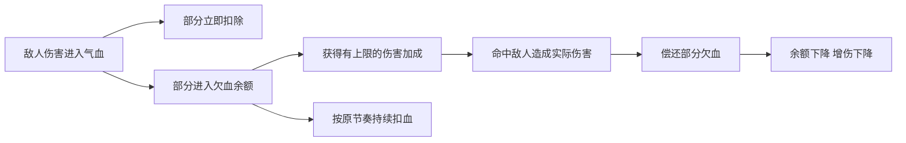
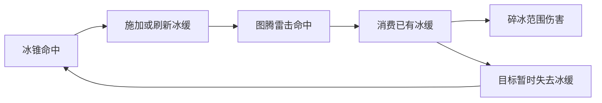

# 暗黑类候选 BD 完整设计与特性缺口

日期：2026 年 10 月 24 日。状态：设计方案。

本文覆盖伤害借贷、蓄伤传爆、冰雷状态消耗、血祭召唤、元素编织五套候选 BD，说明操作、完整循环、装备分工、成长路线、现有能力和需要补充的特性。回刃穿阵归入现有万剑，不另立一个 BD。

五套最小方案合计需要新增 **11 项特性**，其中落雷主动特性可直接使用现有动作制作；另有 **5 项可选进阶特性**。底层能力集中在欠血操作、储伤记录、状态消费、召唤生命周期、施法序列，以及共用的伤害快照结算。本文中的提议 ID 尚未注册，接口描述用于后续设计读取器与运行时，不代表当前可直接编译的 JSON。

## 候选总览

| BD | 玩家主要体验 | 循环的燃料 | 最小方案新增特性 | 主要取舍 |
| --- | --- | --- | --- | --- |
| 伤害借贷 | 顶住一击后持续进攻，用攻击偿还将要扣除的气血 | 已有延迟扣血余额 | 2 项 | 欠血带来伤害，同时构成生存压力；偿还也会降低增伤 |
| 蓄伤传爆 | 集中攻击形成储量，到期爆炸，敌人死亡时转移未释放储量 | 实际造成的命中伤害 | 3 项 | 储存窗口、爆发频率和目标选择 |
| 冰雷状态消耗 | 冰技能持续补冰缓，雷击消耗冰缓产生碎冰爆炸 | 持续补充的冰缓 | 2 项 | 控制覆盖率与消费频率、冰缓强度与直接伤害 |
| 血祭召唤 | 派出召唤物聚敌，选择时机献祭，爆炸并补充下一只 | 有成本、有生命和数量上限的召唤物 | 1 项 | 留场攻击、承担伤害与提前引爆 |
| 元素编织 | 按施法顺序准备不同的终结技，装备逐步接管准备步骤 | 最近三次符合条件的元素施法 | 3 项 | 组合选择、准备时间、魔力与自动化投入 |

## 现有能力与制作约定

### 可以直接复用的能力

| 能力 | 现有特性或实现 | 使用边界 |
| --- | --- | --- |
| 延迟扣血 | `life_loss_deferred`，`Character.deferred` | 已能把一部分实际进入气血的伤害延后扣除，当前不能通过攻击偿还 |
| 回复与偷取 | `leech_life_all`、`area_hit_life`、`proj_hit_life` | 回复实际气血，不会自动减少欠血记录 |
| 异常消费 | `shock_consume`、`freeze_consume`、`ignite_consume`、`poison_threshold_detonate` | 已有感电、冻结、点燃、中毒等各自的消费逻辑，不能把它们重复列成新增能力 |
| 消费触发 | `trig_ailment_consumed` | 已能触发挂载技能；当前消费上下文缺少状态类型、消费强度和层数等详细信息 |
| 冰缓 | `chill`、`chill_effect`、`chill_duration` | 冰缓取最强强度和最长时间，不是可累积毒层 |
| 冰雷来源 | 冰锥术、`lightning_damage`、召唤引雷图腾 | 附加闪电使用独立的 `lightning_damage_hit`，不能只监听普通 `hit` |
| 献祭 | V 键、`trig_sacrifice`、`minion_sacrifice_life`、`minion_sacrifice_shield`、`minion_sacrifice_empower` | 已有主动献祭、回复、转盾、下一技能强化和献祭触发 |
| 召唤物死亡爆炸 | `minion_death_explode`、`minion_death_damage` | 当前只在被杀时生效，主动献祭不会触发这套死亡爆炸 |
| 自动施法 | `trig_cast`、`trig_interval`、`trig_hit`、`trigger_mount`、`trigger_order_sequence`、`trigger_order_rotate` | 已有挂载、顺序、轮换；这些能力不等于记录玩家的施法历史 |
| 目标与资源 | `trigger_at_source`、`trigger_at_event`、`trigger_cost`、触发冷却与储存次数 | 挂载技能继续付出真实成本，不能把触发视作免费施法 |

### 所有候选共同遵守的约定

1. 玩法由特性和集合聚合；战斗代码提供通用能力，不通过 BD 名字、装备名字或某个预制入口决定效果。
2. 必要机制由固定传奇特性提供；允许的数值被动放在传奇基底。下方随机词条继续随机，洗掉全部随机词条后，最小核心循环仍然成立。
3. 有数值的特性使用现有十阶创建层，实例保存实际 `params`；纯机制特性不抽阶。规则 VM 不根据装备 T 阶临时换算伤害。
4. 所有可调量声明参数及单位。数值成长改变强度，新增机制改变构筑阶段，两者分别设计。
5. 次级伤害使用独立命中事件。冰霜元素写 `frost`，需要旧冰冷联动的事件同时带 `frost`、`cold` 标签，新标签登记到族表。
6. 事件分清手动施法、触发施法、召唤攻击、派生伤害、持续伤害和自伤；每项机制明确接受哪些来源。
7. 防递归依靠事件来源、资源实际消费、去重和调度预算共同保证。单次调用的深度限制不能阻止不断创建新施法根的无限循环。
8. 新增主动特性先聚合成普通技能集合，通过现有装备技能绑定进入技能槽；不能把带 `cast` 的主动规则直接当成全局被动，使所有技能同时执行它。

## 伤害借贷

### 操作与完整循环

玩家使用现有攻击或法术作为主输出，装备延迟扣血及新增的偿还、欠血增伤特性。敌人攻击先经过正常防御、护盾等处理，最终进入气血的部分再按既有规则拆为立即扣除与延迟扣除。



起手没有欠血时仍能正常输出；受到攻击后进入高输出窗口。持续命中减少后续扣血压力，停止攻击时剩余欠血继续扣除。普通治疗补回已经损失的气血，偿还只取消尚未扣除的部分。

### 已有特性与新增特性

复用 `life_loss_deferred`、正常主技能、气血上限、防御、命中回复和偷取。延迟扣血来源不重做。

| 优先级 | 提议 ID | 玩家词条写法 | 参数和语义 |
| --- | --- | --- | --- |
| 必需 | `debt_repay_on_hit` | 命中伤害的 n% 用于偿还延迟气血损失，每秒最多偿还最大气血的 m% | `percent` 为伤害转偿还百分比；`cap_percent` 为每秒偿还额度占最大气血的百分比 |
| 必需 | `debt_damage_from_balance` | 每欠下最大气血的 n%，伤害额外提高 m%，最多提高 k% | `per_percent` 为欠血比例步长；`more_percent` 为每步独立增伤；`max_percent` 为增伤上限 |
| 可选 | `debt_repay_on_kill` | 击败敌人时，偿还相当于最大气血 n% 的延迟气血损失 | `percent` 为偿还额度；实际偿还不超过当前余额，按真实击杀去重 |

### 计算与结算顺序

设欠血余额为 D，最大气血为 L，本次对敌方气血实际造成的命中伤害为 H。

```text
欠血占比 q = 100 × D / L
伤害倍率 = 1 + min(max_percent, floor(q / per_percent) × more_percent) / 100
本次偿还 = min(D, H × percent / 100, 当前一秒偿还预算)
```

伤害加成读取本次命中前的余额，实际伤害结算后再偿还。用于偿还的 H 排除过量伤害、自伤、持续伤害和召唤物伤害；派生命中默认不重复产生偿还。数值预算采用随时间补充的额度，不能通过跨整数秒边界瞬间取得双倍额度。

偿还从较早的欠血条目开始减少 `left`，剩余条目保持原扣除速率，不把偿还额变成新的治疗或重新安排更长的扣血期限。多个偿还来源共享同一余额与预算，实际被取消的扣血不能被重复消费。

计算示例仅说明语义：余额为 300，一次合格命中造成 200 实际伤害，偿还比例 20%，本次预算足够，则偿还 40，余额变为 260；玩家当前气血不会因此增加 40。

### 装备与成长

| 阶段 | 机制变化 | 装备分工 |
| --- | --- | --- |
| 起步 | 延迟扣血加攻击偿还，先建立可生存的循环 | 胸甲提供既有延迟扣血；手套固定传奇提供攻击偿还 |
| 成型 | 欠血余额参与输出，形成承伤后的反攻窗口 | 武器固定传奇提供欠血增伤；其他位置补正常防御和回复 |
| 进阶 | 加入击杀偿还，改善高密度战斗中的欠血管理 | 可选传奇提供击杀偿还，Boss 战仍依赖命中偿还 |

全吸收伤害的护盾会减少进入欠血池的量；强回复不会直接偿还欠血。构筑需要同时考虑即时生存和未来扣血。Boss 长时间不攻击时加成自然下降，基础技能继续工作。

### 需要补的底层能力

扩展现有延迟扣血记录的查询与部分取消接口，提供真实偿还结果，并允许伤害计算读取当前余额。动态余额不能塞进目前只接受编译期常量的 `modifiers`。

死亡、重置和新一局开始时沿用角色既有清理流程；普通换层若当前保留角色战斗状态，不得通过换层免费清债。

## 蓄伤传爆

### 操作与完整循环

主技能持续攻击目标，合格命中把部分实际伤害额外记入该目标的储伤记录。第一次记录启动固定的储存窗口，后续攻击增加金额但不刷新结束时间。到期时消耗储量，在目标位置释放范围伤害，然后由下一次合格命中开启新窗口。

目标提前死亡时，其尚未释放的储量按比例转移到附近一个存活敌人；找不到目标时在死亡位置结算。转移使已经投入的伤害继续发挥作用，高密度战斗可形成接续爆发。单体 Boss 依靠反复储存和到期释放完成循环。

```text
命中 → 正常造成伤害，同时登记储量 → 固定窗口结束 → 清空储量并爆炸
                                    ↓ 提前死亡
                     转移未释放储量 → 新目标继续结算
```

### 已有特性与新增特性

复用主技能、普通范围伤害执行、目标位置、伤害记录和空间查询。现有 `counter`、`accumulate`、`consume` 可作为数值累计的参考，但当前没有储伤窗口、死亡转移和完整的储伤生命周期。

| 优先级 | 提议 ID | 玩家词条写法 | 参数和语义 |
| --- | --- | --- | --- |
| 必需 | `damage_bank_on_hit` | 命中伤害的 n% 计入储伤，持续 s 秒 | `percent` 为登记比例；`duration` 为固定窗口秒数；`cap` 为每目标储量上限，单位点 |
| 必需 | `damage_bank_release` | 储伤结束时，释放储量的 n%，爆炸半径 r 米 | `percent` 为释放比例；`radius` 为半径；第一版使用物理伤害，元素选择作为机制配置 |
| 必需 | `damage_bank_transfer_on_kill` | 目标死亡时，将未释放储伤的 n% 转移给 r 米内最近的敌人 | `percent` 限制在 0 到 100；`radius` 为查询半径；只选一个目标，不复制给整群 |
| 可选 | `damage_bank_manual_release` | 主动引爆范围内自己的储伤 | 主动释放特性；`radius` 为查询半径；提前消耗已有储量，不额外赠送储量 |

### 记录和转移的确定行为

1. 按施法者、目标、储伤通道分别记录，包含金额、截止时间、位置和已结算标记。第一次合格命中可以登记本次伤害，正常命中伤害保留。
2. 登记金额使用对敌方气血实际造成的伤害，排除过量伤害。第一版接受玩家主命中，持续伤害、召唤物和派生爆炸默认不进入储伤。
3. 到期先摘除记录，再排队释放。到期、死亡、主动引爆同帧发生时，只允许一个分支消费成功。
4. 提前死亡有可转移目标时，仅转移金额，不在尸体位置再释放同一笔储量。没有目标时使用尸体位置快照释放。
5. 转移保留原截止时间；目标已有记录时合并金额，截止时间取较早者。超出目标上限的金额丢弃并计入诊断，不另生记录。
6. 转移比例不超过 100%。到期记录不再转移，转移本身不造成伤害、不算命中，不重置窗口。
7. 同一死亡事件只转移一次。候选距离相同时按稳定实体 ID 选择，避免网页与 UE 选择不同目标。

设储量为 B，释放比例为 p，则释放额度为 `B × p / 100`。例如已存 500 点，按 80% 释放，得到 400 点释放额度；若提前死亡并按 70% 转移，则下一目标收到 350 点，原记录结束。

储量来自已经计算过玩家增伤的实际伤害，释放时不再重复叠加玩家点伤、普通增伤和暴击；只施加专属储伤修饰以及受击者当时的防御和承伤效果。这个结算策略需要明确补充，当前 `inheritance: explicit` 不能保证整个伤害链跳过上述修饰。

储伤爆炸使用独立 `damage_bank_hit`，其伤害不能回到任何储伤通道。爆炸击杀目标时，可以处理该目标此前由其他合格命中积累的记录，但不能把爆炸金额重新存入。

### 装备与成长

| 阶段 | 机制变化 | 装备分工 |
| --- | --- | --- |
| 起步 | 单目标储存与定时爆炸 | 武器固定传奇负责登记，首饰固定传奇负责释放 |
| 成型 | 死亡转移未释放金额，减少换目标损失 | 另一件固定传奇提供储量转移 |
| 进阶 | 主动提前引爆，控制精英和 Boss 的爆发时机 | 可选主动特性占用正常技能槽，仍消费同一储量 |

主要数值方向为主技能真实输出、记录比例、释放比例和范围。延长窗口会提高单次储量，也会推迟爆发；不能默认把时间越长视作阶级越高越强。Boss 无敌阶段按正常命中规则处理，释放失败不凭空保留已消费储量。

### 需要补的底层能力

增加带截止时间的目标储量、到期调度、原子消费、死亡前转移和已结算伤害的释放策略。死亡处理必须在删除目标与记录之前保存金额和坐标。普通场景清理结束记录，清理行为本身不触发一次全场爆炸。

## 冰雷状态消耗

### 操作与完整循环

玩家先召唤现有引雷图腾，再使用冰锥术持续攻击。冰锥挂冰缓，图腾雷击消费冰缓，在该目标位置引发碎冰爆炸；下一次冰锥命中重新施加冰缓。



消费的是目标当前的状态，施加状态的特性仍然存在。第一版补充来源就是后续冰锥；不需要让爆炸自己补冰缓，也不依靠击杀或冻结。

基础操作使用冰锥和引雷图腾两个已有技能。轻操作变体可用冰锥加已有附加闪电，但必须明确监听 `lightning_damage_hit`，且消费顺序需要按下面的状态快照约定实现。

### 已有特性与新增特性

复用 `chill`、`chill_effect`、`chill_duration`、`summon_storm_totem`、`storm_totem_lightning`、`shock`、`trig_ailment_consumed` 及正常范围和元素属性。

| 优先级 | 提议 ID | 玩家词条写法 | 参数和语义 |
| --- | --- | --- | --- |
| 必需 | `lightning_consume_chill` | 闪电命中时，消耗目标已有的冰缓 | 纯机制；接受持有者自身及其召唤物的合格闪电主命中，以及显式接入的附加闪电事件 |
| 必需 | `chill_consumed_burst` | 消耗冰缓时，造成基础冰霜伤害 +d 点；每 1 个百分点被消耗的冰缓使该伤害提高 n% | `damage` 为基础点伤；`per_slow_percent` 为按消费强度增加的伤害百分比；`radius` 为爆炸半径，单位米 |

新增的落雷主动特性也可以作为雷击来源，但不属于这套最小方案的必需项。

### 状态消费与重新施加

1. 只消费成功命中前已经存在的有效冰缓；未命中、零伤害和不存在冰缓时不产生消费事件。
2. 先取得状态强度和剩余时间快照，成功消费后清除状态，再发出一次带快照的消费事件。多个消费者争抢同一状态时，只有一个成功。
3. 本次雷击即使击杀目标，已成功消费产生的爆炸仍按命中位置快照执行；不能依赖死亡后仍能查询该实体。
4. 一次新的冰缓施加从正常 `apply_status` 入口进入，重新产生有效状态。反复冰缓刷新仍按最强强度和最长时间处理，不会产生虚构的冰缓层数。
5. 碎冰爆炸使用独立 `chill_consumed_hit`。默认不负责再次施加或消费冰缓，不因为带有冰霜标签就接回整条主命中链。
6. 扩展现有消费事件，携带状态类型、实际消费数量、强度、剩余时间、来源和位置。现有 `trig_ailment_consumed` 保持兼容，但本特性只响应冰缓消费。

设实际消费的冰缓强度为 S 个百分点：

```text
碎冰基础伤害 = damage × (1 + S × per_slow_percent / 100)
```

该基础伤害再经过一次正常的冰霜范围伤害修饰，不拿触发雷击的已结算伤害作为第二份底数。冰缓持续时间改善补充与消费的容错，第一版不再额外换算爆炸伤害。

某目标每秒反应次数受到成功补充次数、雷击次数和正常攻击节奏共同限制。没有新的冰缓施加，后续雷击只造成正常雷伤。当前可施加冰缓的 Boss 可以参与循环；真正免疫冰缓的目标无法产生该反应，基础冰雷输出仍保留。

### 装备与成长

| 阶段 | 机制变化 | 装备分工 |
| --- | --- | --- |
| 起步 | 冰锥补状态，图腾消费状态 | 两个技能维持原集合；固定传奇分别提供消费与碎冰爆炸 |
| 成型 | 增强冰缓强度、补充覆盖与雷击节奏 | 基底和正常随机属性补冰缓效果、施法速度、范围与基础点伤 |
| 进阶 | 用显式接入的附加闪电减少操作，或保留图腾覆盖多目标 | 复用现有附加伤害和触发体系，比较反应频率与资源成本 |

过快的消费会让目标更长时间失去减速；只提高雷击频率而没有提高补充覆盖，反应次数不会同比增加。对群体先比较实际被冰缓的目标数，不把命中数量直接当作反应数量。

### 需要补的底层能力

现有 `consume` 操作消费的是 `counter` 等规则累计值，不能写成 `consume key=chill` 就认为删掉了真实状态。需要统一的真实状态消费入口和可供后续动作读取的消费快照。

冰缓保存在规则世界中，毒、感电等还存在运行时的逐层数据。通用入口必须同步真实数据与显示镜像，不能只清图标后被下一帧镜像重新恢复。此入口也可逐步服务既有异常消费，避免新增第二套异常存储。

## 血祭召唤

### 操作与完整循环

玩家召唤现有可移动灵仆，指挥或通过攻击标记让它接近目标；在合适位置施放装备词条授予的“献祭”主动技能。献祭在灵仆位置爆炸，并结算既有献祭回复、转盾和下一技能强化。随后手动补召，或用已有 `trig_sacrifice` 挂载完整的召唤组合补召。

```text
召唤 → 接近并攻击目标 → 主动献祭 → 按召唤物生命结算爆炸
                                      ↓
                           献祭回复与触发补召 → 下一轮
```

起步采用现有 V 键“献祭最早的一个召唤物”的选择方式，不增加新的选择界面。自动补召需要真实魔力、精神占用和数量检查；没有资源时循环会停，剩余召唤物仍按正常规则行动。

### 已有特性与新增特性

复用 `summon_spirit`、`spirit_claw`、召唤物移动和目标指令、`minion_life_base`、`minion_life`、`minion_life_more`、献祭回复、转盾、强化及 `trig_sacrifice`。

| 优先级 | 提议 ID | 玩家词条写法 | 参数和语义 |
| --- | --- | --- | --- |
| 必需 | `minion_sacrifice_explode` | 献祭召唤物时，造成其最大气血 n% 的火焰范围伤害 | `percent` 为生命转伤害百分比；`radius` 为爆炸半径，单位米；读取该召唤物真实属性快照 |
| 可选 | `minion_sacrifice_after_attacks` | 召唤物每完成 n 次攻击后，自动献祭 | `count` 为该召唤物完成的攻击次数；按攻击实例计一次，不按范围内受击人数计数 |

### 生命与结束原因

1. 献祭前保存召唤物 ID、位置、最大气血、当前气血、主人、来源构筑和结束原因，再移除实体。
2. 爆炸以最大气血换算基础伤害；既有献祭转盾继续按剩余气血计算，两者不混用。
3. 第一版把献祭爆炸视作该召唤物的火焰范围伤害，使用其召唤物输出修饰一次，不叠加一整套玩家非召唤点伤。生命已经按继承规则生成，不再重复继承一次。
4. 被杀、主动献祭、自动献祭、到期、替换、场景清理是独立结束原因。新爆炸只响应主动与自动献祭；原有死亡爆炸维持只响应被杀。
5. 一只召唤物只接受一次终结。被杀和献祭同帧竞争时，由第一个成功的终结决定原因，不能同时领取两份爆炸和返还。
6. 自动献祭必须走同一消费入口，支付掉真实召唤物；不能只发一个献祭事件却保留原实体。
7. 爆炸使用独立 `minion_sacrifice_hit`，不伪造一次召唤物普通攻击或新的献祭。补召挂载必须包含召唤主动特性及所需攻击子特性。

### 装备与成长

| 阶段 | 机制变化 | 装备分工 |
| --- | --- | --- |
| 起步 | 手动召唤与 V 键引爆 | 武器提供原召唤技能，一条固定传奇提供献祭爆炸 |
| 成型 | 献祭触发补召，回复和转盾提供容错 | 其他固定传奇装配已有 `trig_sacrifice` 及回复机制；正常属性补精神和魔力 |
| 进阶 | 召唤物完成攻击后自动献祭，玩家负责走位和启动 | 可选固定传奇提供自动献祭；补召速度与资源恢复限制总频率 |

召唤物生命影响单次爆炸，攻击速度影响自动献祭的准备时间，召唤速度与魔力决定补充能力。只堆数量可能提高精神占用并降低单只生命收益；召唤物到不了 Boss 附近时，爆炸也可能打空。

### 需要补的底层能力

给现有召唤生命周期事件补齐属性快照和结束原因，提供规则可调用的通用献祭入口。当前 `trig_sacrifice` 主要传位置，不能直接按已移除召唤物的最大气血计算；现有 `minion_death_explode` 也不能代替献祭爆炸。

## 元素编织

### 操作与完整循环

起步使用四个技能槽：冰锥术、烈焰爆发、新增落雷、序列释放。新增两个主动特性分别聚合成普通技能集合，通过现有装备技能绑定装配。前三个技能成功手动施放后，按主元素记录符文；记录最近三枚，玩家施放序列释放时按有序组合选择配方，并消费整组符文。

```text
成功施放火技能 → 火
再施放冰技能 → 火 冰
再施放雷技能 → 火 冰 雷
序列释放 → 匹配火冰雷配方 → 支付费用并消费符文 → 施放终结技
```

普通施法本身仍有伤害，准备阶段可以打怪。没有匹配配方时保留符文并提示无匹配组合，不扣终结技费用；资源不足时也保留符文。施法成功后才记录，不把按键、冷却中尝试或失败施法记入序列。

### 已有特性与新增特性

复用冰锥与烈焰爆发、现有范围与投射动作、挂载组合、触发调度、顺序释放和资源成本。

| 优先级 | 提议 ID | 玩家词条写法 | 参数和语义 |
| --- | --- | --- | --- |
| 必需 | `element_sequence` | 成功施放元素技能时，记录一枚对应元素符文，保留最近三枚 | `duration` 为符文有效秒数；三枚为该玩法的机制选择，不随 T 阶变动 |
| 必需 | `invoke_sequence` | 消耗三枚符文，按排列顺序施放对应的挂载组合 | 主动释放特性；`mana` 为释放魔力成本；有序配方是集合配置，不能按 BD 名字写分支 |
| 必需 | `create_lightning_strike` | 创建落雷，基础闪电伤害 +d 点 | 主动特性；`damage` 点、`radius` 米、`cooldown` 秒；使用已有 `cast` 和 `damage_area` 即可制作 |
| 可选 | `sequence_include_triggered` | 指定辅助触发施法也可记录元素符文 | 纯机制；只接受显式许可的外部辅助触发来源，不记录终结技及其后代 |
| 可选 | `sequence_auto_invoke` | 符文达到三枚且匹配配方时，自动施放序列释放 | 纯机制；按正常成本、冷却和调度执行，成功后才消费符文 |

`create_lightning_strike` 与既有 `shock` 聚合成落雷技能，继续保留“主动技能由多个特性组成”的结构。不会把冰锥、冰缓和落雷写进一个不可拆分的特性。

### 第一批配方

先配置三种能明显分辨的配方，复用已有伤害形态；配方是普通技能与辅助特性的聚合，不再新增三种战斗执行器。

| 有序符文 | 终结技体验 | 组合方式 |
| --- | --- | --- |
| 火 火 火 | 集中连续爆发 | 烈焰爆发加已有范围重复，火焰主元素 |
| 火 冰 雷 | 落雷覆盖并连锁 | 新落雷主动特性加已有范围和闪电连锁辅助，闪电主元素 |
| 雷 火 冰 | 环形冰锥清理周围 | 既有冰锥加环形发射与多重，冰霜主元素 |

后两种包含相同元素但顺序不同，用于验证排列确实参与选择。第一版允许只有部分序列有配方，UI 应展示可用配方，不能宣称已支持全部排列。

### 序列与自动化的确定行为

1. 每个施法者维护固定容量的有序记录，条目含元素、时间、施法来源和唯一施法实例 ID。一个施法实例最多记一枚；多投射物、多目标和重复伤害不重复记符文。
2. 每枚符文独立到期，过期条目在匹配前移除。容量满时新记录挤掉最早的一枚，不刷新整组的时间。
3. 主元素读取主动特性的施法描述；附加火伤、伤害转化和辅助特性的合并标签不改变符文类型。多元素主动技能必须明确声明记哪种符文。
4. 普通 `cast` 的默认元素和全构筑标签不足以识别主元素，需补通用施法元数据。召唤物自主攻击不属于玩家施法。
5. 配方按有序列表精确匹配；同一施法者同一序列只允许一个释放事务成功。先验证资源与可执行方案，再支付费用、摘除符文并排队施放。
6. 终结技及其派生技能携带来源标记，不能重新记符文。可选的触发记符文只开放指定辅助来源，不取消这个排除。
7. 自动释放冷却中记录达到三枚时，保留最近三枚等待下次检查；不把每一帧的相同序列无限加入队列。资源恢复后可以重新尝试。
8. 终结技可以按配置重复命中，但一次序列消费只记一次释放；每个子技能仍受触发、区域或投射物的正常容量限制。

### 装备与成长

| 阶段 | 机制变化 | 装备分工 |
| --- | --- | --- |
| 起步 | 三种元素手动准备，手动选择释放时机 | 四个技能通过正常绑定占用技能槽；固定传奇提供元素记录 |
| 成型 | 辅助触发代放部分元素技能 | 固定传奇加入 `sequence_include_triggered`；已有挂载数量和顺序辅助安排补充步骤 |
| 进阶 | 一次主施法准备组合后，自动释放终结技 | 固定传奇加入 `sequence_auto_invoke`，需要同时满足资源、记录来源和冷却条件 |

一键变体可让手动火技能触发按顺序挂载的冰、雷辅助技能，形成火冰雷；终结技自身明确排除记符文。施法速度、触发延迟和费用可能使步骤错开，重复启动前要保留完整序列事务，不能靠重排事件日志伪装成功。

### 需要补的底层能力

补充成功施法的主元素与来源元数据、短有序历史、精确配方匹配和原子消费。已有 `trigger_order_sequence` 负责执行顺序，`trigger_order_rotate` 负责轮换挂载技能，二者都不会判断“最近三次施法是火冰雷”。

配方缓存依据普通来源内容和实际参数，不按序列每次重编译。只有换装或配置变化时重新解析可用配方。

## 新增特性汇总

### 最小方案的 11 项

| 序号 | BD | 提议特性 | 底层新增需求 |
| --- | --- | --- | --- |
| 1 | 伤害借贷 | `debt_repay_on_hit` | 欠血实际取消、偿还预算和结算事件 |
| 2 | 伤害借贷 | `debt_damage_from_balance` | 动态读取欠血余额参与伤害计算 |
| 3 | 蓄伤传爆 | `damage_bank_on_hit` | 按施法者和目标保存有截止时间的储量 |
| 4 | 蓄伤传爆 | `damage_bank_release` | 到期消费、排队释放和伤害快照策略 |
| 5 | 蓄伤传爆 | `damage_bank_transfer_on_kill` | 死亡前转移及稳定目标选择 |
| 6 | 冰雷状态消耗 | `lightning_consume_chill` | 真正消费状态，显式接入闪电来源 |
| 7 | 冰雷状态消耗 | `chill_consumed_burst` | 读取消费快照，产生独立碎冰伤害 |
| 8 | 血祭召唤 | `minion_sacrifice_explode` | 献祭属性快照、结束原因和伤害归属 |
| 9 | 元素编织 | `element_sequence` | 成功施法元数据与短有序历史 |
| 10 | 元素编织 | `invoke_sequence` | 配方匹配、支付与原子消费 |
| 11 | 元素编织 | `create_lightning_strike` | 只新增特性和技能数据，复用已有动作 |

### 可选进阶的 5 项

| BD | 提议特性 | 增加的玩法 |
| --- | --- | --- |
| 伤害借贷 | `debt_repay_on_kill` | 清群时以击杀缓解欠血 |
| 蓄伤传爆 | `damage_bank_manual_release` | 玩家决定提前爆发时机 |
| 血祭召唤 | `minion_sacrifice_after_attacks` | 从手动引爆转为攻击后自动献祭 |
| 元素编织 | `sequence_include_triggered` | 辅助触发代替部分手动准备 |
| 元素编织 | `sequence_auto_invoke` | 准备完成后自动释放终结技 |

冰雷方案的轻操作变体优先复用已有附加闪电，不另造一个“自动冰雷 BD”专用开关。

## 共用规则接口与实现位置

以下是语义合同，具体 JSON 字段须随读取器、编译器和测试一起设计。允许规则发起这些操作，并通过标准结果继续组合；UI、预制 BD 菜单和装备名字不直接操作战斗数据。

| 通用能力 | 必须提供的结果与约束 | 现有承接位置 |
| --- | --- | --- |
| 欠血查询与偿还 | 当前余额、实际偿还额、共享预算；偿还不会恢复当前气血 | `engine/character.mjs`、`engine/combat/runtime.mjs` |
| 有时限的目标储量 | 金额、施法者、目标、通道、截止时间、最后位置；消费与转移最多成功一次 | 规则状态与事件调度，新增独立模块承接生命周期 |
| 状态消费与快照 | 状态类型、层数、强度、剩余时间、来源、位置、消费成功与否；同步逐层运行时和镜像 | `engine/world.mjs`、`engine/combat/ailments.mjs`、`engine/combat/triggers.mjs` |
| 召唤物结束操作 | 唯一实体、结束原因、生命和位置快照；死亡、献祭、到期、替换分别分发 | `engine/combat/minions.mjs`、召唤生命周期事件 |
| 施法序列 | 成功施法的主元素、来源、唯一实例、短历史、匹配和消费结果 | 施法入口、`engine/combat/triggers.mjs`、集合解析 |
| 已结算伤害释放 | 明确普通基础伤害与已结算额度的区别，防止重复加点伤、暴击和普通增伤 | `engine/world.mjs` 的伤害入口及伤害修饰接口 |

现有 `consume` 继续表示规则累计值消费；真实状态消费与欠血偿还分别调用对应权威数据源。共用事件上下文按需要提供结构化信息，不能只用一个模糊的 `event.amount` 同时表示层数、强度、气血和伤害。

涉及新动作、条件或表达式时，修改 `reader.mjs`、`compiler.mjs`、类型枚举和合法字段校验。若进入网站与 UE 共用能力，C++ 的 `DWRulesCore` 同步实现同一语义，并用 parity 验证；不能只共享 JSON 就宣称运行时一致。

## 装备分配与十阶数值

必要机制按各节的装备分工放入固定传奇词条；一件装备仍只有一条固定传奇词条。多项必要机制分配到多件装备，基底只放现有约定允许的被动数值或被动机制，不往基底塞主动规则、挂载组合或持续时间包装。

商店、掉落、鉴定、洗炼与预制 BD 应读取同一装备定义和实例生成器。预制应用后可直接体验，正常购买相同装备也必须得到相同核心机制。随机词条只提升点伤、范围、速度、回复等强度，不负责保证循环成立。

数值参数需要写入 `Values/trait_tiers.json`：

- 伤害比例、点伤、范围和上限使用对应单位与合理边界；转移比例、概率等受百分比语义限制。
- 欠血增伤步长、储伤窗口、自动献祭攻击次数和触发间隔存在正负收益，逐项确定阶级方向和边界，不机械把所有数值增大当成更强。
- 元素选择、结束原因、记录来源、配方序列等是机制选择，不参与阶级随机；三枚符文的机制不因 T 阶变成六枚。
- 同一条复合特性的参数按照同一词条阶级创建。循环在低阶也必须成立，高阶提高效率或容错。

计算除数和次数参数必须大于零；储伤窗口、符文有效期和可调度间隔采用引擎允许的正值范围，百分比和半径使用明确边界。非法参数应在读取或集合创建时拒绝，不靠战斗中反复补救。

本方案中的计算例用于明确单位与结算，不承诺已达到某个 DPS。定值前在真实资源、正常怪物防御及当前爬塔 30 秒失败条件下测量，区分单体、群体和过量伤害。

## 性能与诊断

1. 欠血偿还维护总余额和受限记录，不在每次命中重新编译技能，也不无限保留已偿还条目。
2. 储伤只保存累计金额和少量时间信息，不为每次命中保留一条完整伤害日志；到期调度集中处理。
3. 死亡转移只在需要时查询一次附近敌人，优先复用空间索引，避免每帧对全部目标两两扫描。
4. 状态消费在现有状态容器中完成；符文历史固定三枚。UI 读取快照，不参与任何伤害与消费计算。
5. 新的挂载来源在换装、配方变化时编译并缓存。固定来源与参数的战斗事件只排队执行。
6. 派生爆炸、自动献祭和自动释放共用可观测的每帧预算，溢出按既有调度策略延后；不能静默丢弃已支付资源的效果。
7. 诊断至少记录欠血产生与偿还、储量登记与释放与转移、消费状态类型与强度、献祭原因与生命快照、符文追加与匹配与消费。借助这些数据定位“词条有显示但没有联动”。
8. 压测覆盖 20 到 300 只怪物，比较开启前后的帧耗时、峰值队列、存储数量和实际事件数；不把表现层粒子数量当作规则生效次数。

## 验收清单与开发顺序

### 必须覆盖的行为

| 范围 | 验证项 |
| --- | --- |
| 伤害借贷 | 实际进入气血才产生对应欠血；攻击偿还减少未来扣血，不增加当前气血 |
| 伤害借贷 | 未命中、过量伤害、自伤和不支持的来源不产生额外偿还；共享预算不被多段绕过 |
| 伤害借贷 | 本次伤害读取命中前余额；断攻击、无敌 Boss、死亡和重置正确 |
| 蓄伤传爆 | 首次计入、后续不刷新窗口、每目标独立、同一施法者正确归属 |
| 蓄伤传爆 | 到期、死亡、主动引爆同帧不重复消费；转移不复制金额、不延后截止时间 |
| 蓄伤传爆 | 释放不重新计入任意储伤通道；玩家点伤与暴击不重复结算 |
| 冰雷状态消耗 | 连续冰锥能重复补状态，连续无补充雷击不能反复消费同一状态 |
| 冰雷状态消耗 | 冰缓不是层数；成功消费前后的强度、时间和图标与权威数据一致 |
| 冰雷状态消耗 | 普通雷击、引雷图腾、附加闪电独立事件按许可接入；击杀瞬间保留爆炸坐标 |
| 血祭召唤 | V 键献祭使用真实召唤物生命；被杀、献祭、到期、替换和场景清理不串事件 |
| 血祭召唤 | 自动补召有成本，完整攻击子特性存在；无召唤物或资源不足时正常停转 |
| 血祭召唤 | 一只召唤物终结一次；自动献祭按攻击实例计数，范围命中人数不加速计数 |
| 元素编织 | 一次成功施法只记一枚；失败施法、附加元素、多投射物和终结技不误记 |
| 元素编织 | 同元素集合不同顺序得到不同匹配；符文逐枚过期，容量替换正确 |
| 元素编织 | 无配方或无魔力不消费；自动释放冷却中不反复排队；终结技不能重新补符文 |
| 集合与装备 | 去掉所有随机词条仍能运转；购买、掉落与预制应用使用同一份固定机制 |
| 参数与平台 | 低阶与高阶均验证参数覆盖；共用运行时的同种子事件与结果通过网页和 UE parity |
| 实战与性能 | 单体 Boss、三波怪和 20 到 300 密度；正常资源、30 秒限制、队列和内存稳定 |

### 建议开发顺序

1. **冰雷状态消耗**：先做真实状态消费和快照，复用现有冰锥、引雷图腾验证施加、消费、重新施加的完整链。
2. **血祭召唤**：补生命周期快照，先验证手动献祭爆炸，再使用已有触发补召；自动献祭后置。
3. **伤害借贷**：扩展既有延迟扣血，先验证取消扣血，再加入动态增伤，重点验证生存结算。
4. **蓄伤传爆**：明确已结算伤害策略后，再实现记录、到期释放与死亡转移。
5. **元素编织**：补施法元数据和短历史，先做手动三配方，再开放许可的辅助记录和自动终结。

每一套先完成固定机制的最小版本及对应测试，再做装备和数值标定。先跑通完整循环，再增加自动化；不通过升级全部词条 T 阶代替玩法成长。

## 对照代码与规范

- [特性制作规范](trait-spec.md)：合法字段、事件深度、次级伤害、十阶与聚合约定。
- [装备基底词缀](equipment-bases.md)：固定基底、固定传奇、正常随机词条和统一生成。
- [战斗特性目录](../engine/combat-catalog.mjs)：已有异常消费、献祭、触发与挂载能力。
- [角色运行时](../engine/character.mjs)：`deferred`、延迟扣血、气血回复与真实承伤。
- [异常运行时](../engine/combat/ailments.mjs)：真实逐层状态、消费、镜像和派生伤害边界。
- [伤害运行时](../engine/combat/runtime.mjs)：既有感电和冻结消费参与伤害计算的时机。
- [触发运行时](../engine/combat/triggers.mjs)：挂载、顺序、上下文、资源和触发来源过滤。
- [召唤运行时](../engine/combat/minions.mjs)：被杀、主动献祭、替换和到期的区别。
- [规则世界](../engine/world.mjs)：累计值消费、真实状态、伤害计算和事件队列。
- [冰缓定义](../../../Content/Rules/Statuses/chill.json)：最强强度与最长时间，不叠层。
- [引雷图腾集合](../../../Content/Rules/Builds/storm_totem.json)：现有召唤主动、攻击子特性与感电的聚合。
